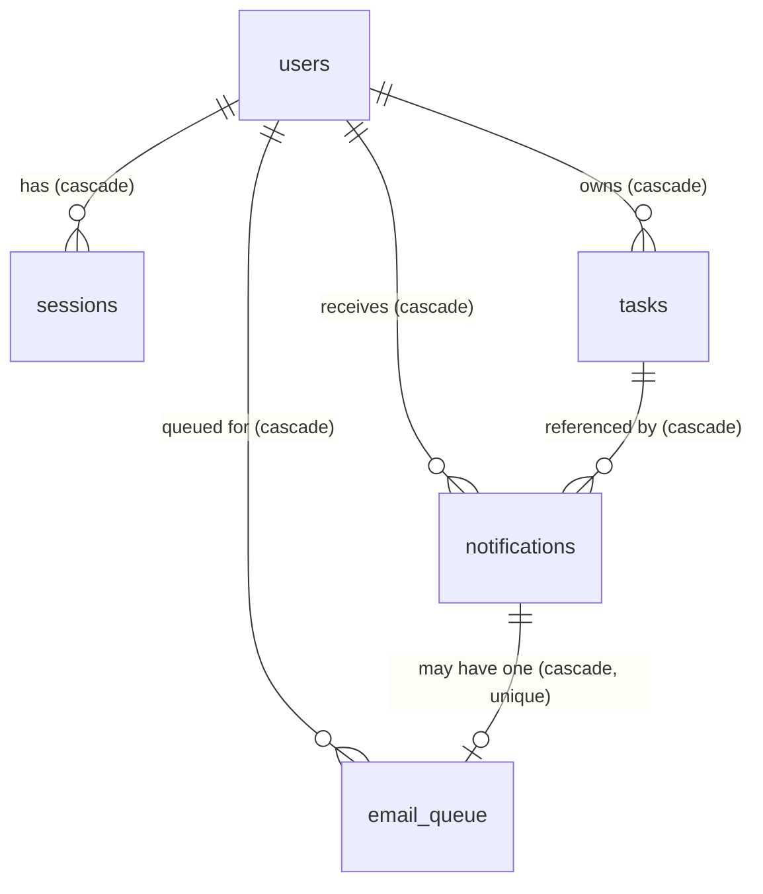

# DATABASE.md — Student Task Manager

**Stage 4 deliverable.** SQLite (better-sqlite3), WAL mode, foreign keys ON. All timestamps stored as **UTC ISO-8601 text** (`YYYY-MM-DDTHH:MM:SS.sssZ`) — lexicographically sortable, human-inspectable, no driver date surprises. Booleans as INTEGER 0/1. IDs as INTEGER primary keys (rowid aliases).

---

## 1. Entities

### users

| Column                  | Type    | Constraints                            |
| ----------------------- | ------- | -------------------------------------- |
| id                      | INTEGER | PK AUTOINCREMENT                       |
| name                    | TEXT    | NOT NULL, 1–100 chars (app-validated)  |
| email                   | TEXT    | NOT NULL, **UNIQUE**, stored lowercase |
| password_hash           | TEXT    | NOT NULL (bcrypt, cost 12)             |
| email_reminders_enabled | INTEGER | NOT NULL DEFAULT 1                     |
| created_at              | TEXT    | NOT NULL DEFAULT (UTC now)             |
| updated_at              | TEXT    | NOT NULL DEFAULT (UTC now)             |

### sessions

| Column     | Type    | Constraints                                                          |
| ---------- | ------- | -------------------------------------------------------------------- |
| token_hash | TEXT    | PK (SHA-256 hex of the random cookie token — raw token never stored) |
| user_id    | INTEGER | NOT NULL → users(id) ON DELETE CASCADE                               |
| created_at | TEXT    | NOT NULL                                                             |
| expires_at | TEXT    | NOT NULL (indexed for pruning)                                       |

### tasks

| Column       | Type    | Constraints                                                                                                                                                                                                                                                                            |
| ------------ | ------- | -------------------------------------------------------------------------------------------------------------------------------------------------------------------------------------------------------------------------------------------------------------------------------------- |
| id           | INTEGER | PK AUTOINCREMENT                                                                                                                                                                                                                                                                       |
| user_id      | INTEGER | NOT NULL → users(id) ON DELETE CASCADE — **ownership: a task belongs to exactly one student**                                                                                                                                                                                          |
| title        | TEXT    | NOT NULL, 1–200 (app-validated)                                                                                                                                                                                                                                                        |
| description  | TEXT    | NOT NULL DEFAULT '' , ≤ 5000                                                                                                                                                                                                                                                           |
| subject      | TEXT    | NOT NULL, 1–100                                                                                                                                                                                                                                                                        |
| type         | TEXT    | NOT NULL CHECK (type IN ('assignment','project','exam','study','other'))                                                                                                                                                                                                               |
| priority     | TEXT    | NOT NULL CHECK (priority IN ('high','medium','low')) DEFAULT 'medium'                                                                                                                                                                                                                  |
| status       | TEXT    | NOT NULL CHECK (status IN ('pending','in_progress','completed')) DEFAULT 'pending'                                                                                                                                                                                                     |
| due_at       | TEXT    | NULL allowed (unscheduled tasks); UTC ISO with time                                                                                                                                                                                                                                    |
| completed_at | TEXT    | NULL; set when status → completed, cleared when reopened (app-enforced + CHECK consistency: `CHECK ((status='completed') = (completed_at IS NOT NULL))` is intentionally NOT added — reopen flows set both in one transaction instead, keeping the constraint simpler to reason about) |
| created_at   | TEXT    | NOT NULL                                                                                                                                                                                                                                                                               |
| updated_at   | TEXT    | NOT NULL                                                                                                                                                                                                                                                                               |

### notifications

| Column                             | Type    | Constraints                                                                                                                                                                                                                                                                  |
| ---------------------------------- | ------- | ---------------------------------------------------------------------------------------------------------------------------------------------------------------------------------------------------------------------------------------------------------------------------- |
| id                                 | INTEGER | PK AUTOINCREMENT                                                                                                                                                                                                                                                             |
| user_id                            | INTEGER | NOT NULL → users(id) ON DELETE CASCADE                                                                                                                                                                                                                                       |
| task_id                            | INTEGER | NULL → tasks(id) ON DELETE CASCADE (task deletion cleans its notifications)                                                                                                                                                                                                  |
| kind                               | TEXT    | NOT NULL CHECK (kind IN ('deadline_soon_24h','deadline_soon_1h','overdue','welcome'))                                                                                                                                                                                        |
| title                              | TEXT    | NOT NULL                                                                                                                                                                                                                                                                     |
| body                               | TEXT    | NOT NULL                                                                                                                                                                                                                                                                     |
| read_at                            | TEXT    | NULL (NULL = unread)                                                                                                                                                                                                                                                         |
| created_at                         | TEXT    | NOT NULL                                                                                                                                                                                                                                                                     |
| **UNIQUE(user_id, kind, task_id)** |         | **Dedup guarantee:** at most one reminder of each kind per task per user; scheduler uses `INSERT OR IGNORE`. (SQLite treats NULLs as distinct in unique indexes, but reminder kinds always carry a task_id; `welcome` is inserted once per user at registration by the app.) |

### email_queue

| Column               | Type    | Constraints                                                                                    |
| -------------------- | ------- | ---------------------------------------------------------------------------------------------- |
| id                   | INTEGER | PK AUTOINCREMENT                                                                               |
| notification_id      | INTEGER | NOT NULL → notifications(id) ON DELETE CASCADE, **UNIQUE** (one email per in-app notification) |
| user_id              | INTEGER | NOT NULL → users(id) ON DELETE CASCADE                                                         |
| to_email             | TEXT    | NOT NULL                                                                                       |
| subject              | TEXT    | NOT NULL                                                                                       |
| body_text            | TEXT    | NOT NULL (plain text — sufficient for reminders, avoids HTML injection surface)                |
| state                | TEXT    | NOT NULL CHECK (state IN ('pending','sent','skipped_no_smtp','failed')) DEFAULT 'pending'      |
| attempts             | INTEGER | NOT NULL DEFAULT 0 (max 3 then failed)                                                         |
| last_error           | TEXT    | NULL                                                                                           |
| created_at / sent_at | TEXT    | NOT NULL / NULL                                                                                |

### schema_migrations

| Column     | Type    | Constraints                    |
| ---------- | ------- | ------------------------------ |
| version    | INTEGER | PK (e.g. 1 for `001_init.sql`) |
| name       | TEXT    | NOT NULL                       |
| applied_at | TEXT    | NOT NULL                       |

## 2. ER Diagram



## 3. Indexes (for the actual query patterns)

```sql
CREATE INDEX idx_tasks_user_due        ON tasks(user_id, due_at);          -- calendar range, deadline buckets, scheduler scan
CREATE INDEX idx_tasks_user_status_due ON tasks(user_id, status, due_at);  -- dashboard open-work queries, smart sort
CREATE INDEX idx_tasks_user_priority   ON tasks(user_id, priority);        -- priority filter/analytics
CREATE INDEX idx_tasks_user_subject    ON tasks(user_id, subject);         -- subject filter/workload
CREATE INDEX idx_tasks_user_updated    ON tasks(user_id, updated_at DESC); -- default list ordering
CREATE INDEX idx_sessions_user         ON sessions(user_id);               -- logout-all, ownership prune
CREATE INDEX idx_sessions_expires      ON sessions(expires_at);            -- expiry pruning
CREATE INDEX idx_notifs_user_unread    ON notifications(user_id, read_at); -- bell count, panel list
CREATE INDEX idx_notifs_user_created   ON notifications(user_id, created_at DESC);
CREATE INDEX idx_emailq_state          ON email_queue(state, created_at);  -- queue pickup
```

Free-text search (`LIKE`/`instr` over title/description/subject scoped by `user_id`) deliberately does **not** get an FTS5 index: at student scale (hundreds of rows/user) a parameterized `LIKE '%q%'` over an already user-scoped set is fast and far simpler; FTS5 is logged as a future optimization if data grows.

## 4. Constraints & Integrity Rules (app + DB)

- **Ownership everywhere:** every task/notification read or write includes `WHERE user_id = ?`. Routes return 404 (not 403) for another user's resource id — no existence leaks.
- **Status/completed_at consistency:** enforced in the service layer inside a single transaction (complete ⇒ set `completed_at`; reopen ⇒ clear it).
- **Deadline semantics:** `overdue` ⇔ `due_at < now AND status != 'completed'`. Buckets computed in SQL against a passed-in `now` parameter (testable, timezone-safe since all storage is UTC).
- **Email uniqueness:** enforced by DB unique index + normalized lowercase compare; registration/login are case-insensitive on email.
- **Cascades:** deleting a user removes sessions/tasks/notifications/queue rows; deleting a task removes its notifications (and their queue rows). No orphans possible.
- **Foreign keys:** `PRAGMA foreign_keys = ON` per connection (SQLite default is OFF — explicitly enabled and asserted at boot).

## 5. Connection & Runtime Settings

```sql
PRAGMA journal_mode = WAL;        -- concurrent reads while scheduler writes
PRAGMA synchronous = NORMAL;      -- safe with WAL, fast
PRAGMA foreign_keys = ON;
PRAGMA busy_timeout = 5000;       -- wait rather than SQLITE_BUSY on lock contention
```

Single shared connection instance (better-sqlite3 is synchronous; one process ⇒ one connection is the recommended pattern). `DB_PATH` defaults to `server/data/stms.sqlite`; `:memory:` supported for tests. Directory auto-created; data dir gitignored.

## 6. Migration Strategy

- Files: `server/src/db/migrations/NNN_name.sql`, applied in order inside a transaction by `migrate.ts`; recorded in `schema_migrations`; already-applied versions skipped (idempotent boot). Runner fails fast on missing/out-of-order versions.
- **Deploy rule:** migrations run automatically at server start (single-instance deployment ⇒ no migration lock contention). Down-migrations are not built; forward-fix policy (documented in DEPLOYMENT.md), standard for small apps.
- Current set: `001_init.sql` — full schema above.

## 7. Seed Strategy (development only)

`npm run seed` (server workspace) creates **demo student** `demo@stms.dev` / `Demo1234!` (printed to console, dev-only) with ~28 realistic tasks across 5 subjects (Mathematics, Physics, Data Structures, English, History), all 4+1 types, all 3 priorities, all statuses, and due dates spanning −10 days … +30 days (guaranteed overdue/today/soon/later/unscheduled coverage), plus a welcome notification. Seed is idempotent (skips if demo user exists) and refuses to run when `NODE_ENV=production`. Seed data is dev scaffolding — clearly labeled, never shipped as "real" usage data.

Tests use their own fixtures (factories in `tests/helpers.ts`), not the dev seed.
